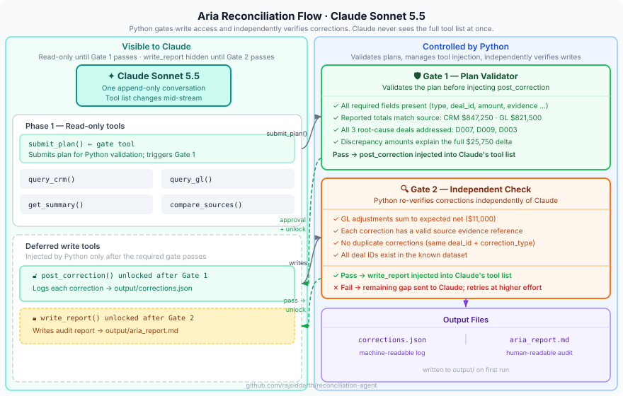

# Aria — Reconciliation Agent

A runnable Python companion project for exploring the **Claude Sonnet 5.5 Messages API**.

Aria investigates a fictional October 2026 revenue mismatch between a CRM export and a General Ledger, submits an evidence-backed correction plan, and receives write access only after Python validates that plan.

---

## The Scenario

| Source | Reported Total | Records |
|--------|---------------|---------|
| CRM / Billing | $847,250.00 | 12 |
| GL / Ledger | $821,500.00 | 11 |
| **Delta** | **$25,750.00** | — |

Three bugs are hidden in the data. Aria must find all of them through tool calls — no guessing.

---

## What This Demonstrates

- **`@beta_tool` decorator** — define tools as typed Python functions; the SDK generates schemas automatically
- **Tool Runner** — `client.beta.messages.tool_runner(...)` manages the agentic loop; no hand-written `while` loop required
- **Parallel tool calls** — Aria may call `query_crm` and `query_gl` simultaneously in one turn
- **Two-gate permission pattern** — write access is gated twice: Gate 1 validates the plan; Gate 2 independently re-verifies the corrections Claude actually posted
- **Adaptive thinking** — Sonnet 5.5 reasons through ambiguous cases without extra configuration
- **Audit trail** — every correction references the source record that justified it

---

## Project Structure

```
aria/
├── agent.py           # Two-phase orchestrator + submit_plan gate tool
├── state.py           # Shared mutable state between phases
├── validator.py       # CorrectionPlan validation logic (the gate)
├── tools/
│   ├── read_tools.py  # query_crm, query_gl, get_summary, compare_sources
│   └── write_tools.py # post_correction, write_report (injected after gate)
└── data/
    ├── crm_october.json   # Fictional CRM export (contains bugs)
    └── gl_october.json    # Fictional GL export (contains bugs)
run.py                 # Entry point
requirements.txt
output/                # Created on first run
    corrections.json   # Machine-readable correction log
    aria_report.md     # Human-readable audit report
```

---

## Quick Start

```bash
# 1. Install dependencies
pip install -r requirements.txt

# 2. Set your API key (or use `ant auth login`)
export ANTHROPIC_API_KEY=sk-ant-...

# 3. Run Aria
python run.py
```

---

## Architecture



## How the Two-Gate Pattern Works

```
Phase 1 — Read-only tools
  Aria calls: get_summary → compare_sources → query_crm/query_gl → submit_plan()
                                                                          │
                                                               Gate 1 — Plan Validator
                                                               ✓ Required fields present
                                                               ✓ Totals match source data
                                                               ✓ All 3 deals addressed (D007, D009, D003)
                                                               ✓ Amounts explain the full $25,750 delta
                                                                          │
                                                               ✗ fail → feedback sent, Aria revises
                                                               ✓ pass → post_correction injected

Phase 2a — Corrections (post_correction only)
  Aria calls: post_correction() × N   [write_report not yet available]
                                                                          │
                                                               Gate 2 — Independent Check
                                                               ✓ GL adjustments sum to expected $11,000
                                                               ✓ Each correction has evidence reference
                                                               ✓ No duplicate corrections
                                                               ✓ All deal IDs are valid
                                                                          │
                                                               ✗ fail → remaining gap sent, Aria retries
                                                               ✓ pass → write_report injected

Phase 2b — Report (write_report only)
  Aria calls: write_report()
```

Both gates are plain Python functions in [`aria/validator.py`](aria/validator.py). No API feature enforces them — the orchestrator in [`aria/agent.py`](aria/agent.py) controls the tool list at each phase.

**Why two gates?** Gate 1 checks the *plan* Claude describes. Gate 2 re-verifies the *corrections Claude actually posted* — independently, without relying on Claude's own summary of what it did.

---

## Model

This project uses **`claude-sonnet-5-5`** — fast, capable, and cost-effective for an educational agentic loop. Adaptive thinking is on by default.

---

## Output

After a successful run:

**`output/corrections.json`** — each correction as a structured record with deal ID, type, amount, evidence reference, and timestamp.

**`output/aria_report.md`** — executive summary, per-deal findings, and reconciled totals in Markdown.
